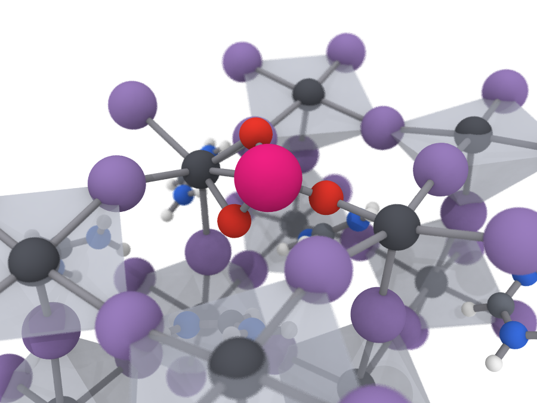

# Figure style for structure renders

Implemented in `src/pvpassivator/render.py`; use it for every structure figure so panels across papers match.
Example (`docs/figure_style_example.png`): iodate on a PbI₂-terminated FAPbI₃(100) slab, perspective view.



## Rules

| Element | Choice |
|---|---|
| Renderer | OVITO + Tachyon, ambient occlusion (brightness 0.8, 24 samples), soft shadows, 24× antialiasing, white background |
| Framework | Light semi-transparent PbX₆ octahedra (RGB 0.78/0.80/0.86, transparency 0.55, no edge highlight) **plus** Pb–X sticks |
| Bonds | Thin uniform grey cylinders (0.22 Å, RGB 0.55/0.55/0.58); Pb–X ≤ 3.6 Å, Pb–O ≤ 2.8, Pb–N ≤ 2.9, Pb–S ≤ 3.2, covalent pairs 1.15 × radius sum |
| Atoms | Pb dark slate, I muted violet, C grey, N blue, H white, O red, S yellow (see `COLORS`, `RADII`) |
| Organic cations | Ball-and-stick with element colours, H shown (never one blob per cation) |
| Focus | One atom per figure in magenta (0.86/0.12/0.47), 1.2× its radius |
| Halo | Optional translucent gold sphere (1.00/0.76/0.18, transparency 0.55) for a second site of interest |
| New bonds to the surface | A Pb bonded to an adsorbate donor (O, N, S, F) gets no octahedron, so the bond reads |
| Cutout | Rotate the outward normal to +z; replicate 3×3 laterally; keep a disc (default 9 Å) around the focus. Periodic copies of the focus fragment are dropped, so an adsorbate appears once. Display only: no atom moves |

## Views

- `side`: orthographic, looking along an in-plane direction with a slight downward tilt (−0.22), vacuum up.
- `top`: orthographic along −normal.
- `persp`: oblique perspective (direction 0.62/0.45/−0.50) with depth of field focused on the focus atom.

Same camera, scale and colours for every panel of one figure. Compose multi-panel figures with
`pvpassivator.compose.compose_panels` in a separate process (OVITO and matplotlib clash on exit): bold panel letters,
optional titles, one element legend in the render colours, and a scale bar only when the renders' px/Å is known.

- Highlight a whole adsorbed molecule with `render(..., highlight=[its atom indices])`: atoms ~12 % larger and tinted
  toward the halo gold. Say "highlighted" in the caption: the tint shifts colours away from the legend discs.
- A Pb whose octahedron cannot be shown complete (bonded to the dropped periodic copy of the focus fragment) is drawn
  without one, like a Pb bonded to an adsorbate donor.
- Web pages: export with `render.cutout_to_web(display_cutout(...))` and draw the listed bonds and octahedra; never
  let the viewer guess bonds.

## Usage

```python
from ase.io import read
from pvpassivator.render import render
atoms = read("CONTCAR")
render(atoms, "fig_side.png", focus=134, normal_axis=2, view="side")
render(atoms, "fig_persp.png", focus=134, normal_axis=2, view="persp", halo=[192])
```
`pip install -e .[render]` adds OVITO. `display_cutout` (geometry only) needs no OVITO and is unit-tested.
